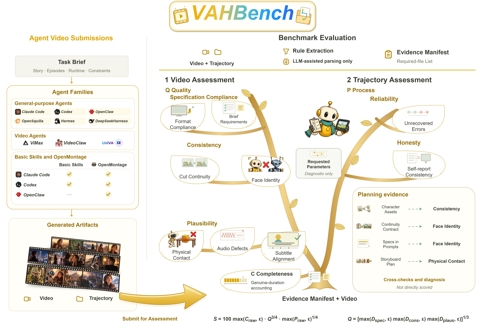
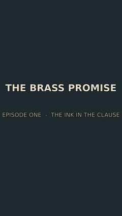

# VAHBench

**A harness benchmark for agentic long-video generation.**
Can an AI agent read a brief and turn it into a complete video series?
VAHBench gives agents five short-drama briefs and scores what they deliver.

[Paper (PDF)](https://arxiv.org/pdf/2611.20535) ·
[Dataset (Hugging Face)](https://huggingface.co/datasets/TokenRhythm/VAHBench) ·
[Baseline examples](#2-baseline-examples) ·
[Setup and usage](#3-setup-and-usage) ·
[Citation](#citation)

<p align="center">
  
</p>

## 1. The benchmark

An agent receives a brief that fixes the story, cast, dialogue, number of
episodes and length. It plans and produces the series on its own with shared
generation tools. VAHBench then scores the saved videos and the saved
execution trace:

| Score | What it measures | Evidence |
|---|---|---|
| **C** Completeness | Seconds of genuine footage against the requested runtime. Held, blank and repeated footage, broken splices and artificial slowdown earn no credit. | Videos |
| **Q** Quality | Specification, consistency and plausibility of the delivery. | Videos |
| **P** Process | Reliability of production tasks and honesty of the agent's claims. | Trace |

`S = 100 · max(C, ε) · Q^(3/4) · max(P, ε)^(1/4)`, with `ε = 0.05`.
Completeness gates the total, so a long file of filler cannot score well. A
language model only helps to parse logs; every score comes from fixed rules.

The five briefs, B1 to B5, ask for 3 × 60 s, 3 × 120 s, 5 × 120 s, 5 × 240 s
and 6 × 300 s. The paper reports 240 runs from 12 systems with four text
models each.

The [Hugging Face dataset](https://huggingface.co/datasets/TokenRhythm/VAHBench)
is organized into two parts:

- [`benchmark/`](https://huggingface.co/datasets/TokenRhythm/VAHBench/tree/main/benchmark):
  the five full prompts, structured requirements and evaluation configuration.
- [`examples/`](https://huggingface.co/datasets/TokenRhythm/VAHBench/tree/main/examples):
  three showcase runs per prompt, with 66 episode videos and execution traces
  across 15 runs. These include the three baseline examples below.

This curated showcase is a subset of the runs reported in the paper.

The code follows the five stages of the evaluation pipeline in the paper:

| Stage | Directory | Role |
|---|---|---|
| 1 Brief & Trace | `stage1_inputs/` | Read the brief and the trace into a structured checklist |
| 2 Delivered Videos | `stage2_delivery/` | Locate the delivered episodes |
| 3 Evidence Extraction | `stage3_evidence/` | Collect frames, cuts, audio and subtitles |
| 4 Detectors & Cross-checks | `stage4_checks/` | Run detectors and check claims against files |
| 5 C / Q / P | `stage5_scoring/` | Compute C, Q, P and S |

Around them: `run.py` is the entry point, `config/` holds the settings,
`shared/` the helpers every stage uses, `reference_detectors/` the bundled
detectors, `examples/` three baseline runs and `tests/` the test suite.

## 2. Baseline examples

Three runs, one for each kind of delivery, are bundled in
[`examples/`](examples) with their execution trace and delivered episodes.
Scores are those reported in the paper for these runs. Each preview shows ten
seconds of episode 1 and links to the full video.

<table>
  <tr>
    <th width="33%">Complete delivery</th>
    <th width="33%">Padded delivery</th>
    <th width="33%">Static filler</th>
  </tr>
  <tr>
    <td align="center"><a href="examples/opensquilla/deepseek-V4-flash/prompt_01_the_woman_behind_the_numbers/out/episode1.mp4"></a></td>
    <td align="center"><a href="examples/hermes/deepseek-V4-flash/prompt_03_terms_of_the_borrowed_vow/seapromise/final/THE_BRASS_PROMISE_EP1_1.mp4"></a></td>
    <td align="center"><a href="examples/openclaw/deepseek-V4-flash/prompt_03_terms_of_the_borrowed_vow/video/ep1_the_bargain_FINAL.mp4"></a></td>
  </tr>
  <tr>
    <td>OpenSquilla + deepseek-v4-flash, B1<br>Every episode is 60 s of generated footage.</td>
    <td>Hermes + deepseek-v4-flash, B2<br>Title and end cards are held for 9 to 12 s per episode.</td>
    <td>OpenClaw + deepseek-v4-flash, B2<br>Each 120 s episode is a sequence of still images.</td>
  </tr>
  <tr>
    <td><b>S 54.9</b><br>C 1.00 · Q 0.45</td>
    <td><b>S 42.4</b><br>C 0.66 · Q 0.55</td>
    <td><b>S 1.9</b><br>C 0.05 · Q 0.74</td>
  </tr>
</table>

The third run has the highest quality and the lowest total: still images look
clean, but they are not the footage the brief asked for.

Where to find each example, relative to `examples/`:

| Example | Run directory | Trace | Videos |
|---|---|---|---|
| Complete | `opensquilla/deepseek-V4-flash/prompt_01_the_woman_behind_the_numbers/` | `.opensquilla/trajectory-exports/trajectory/events.jsonl` | `out/` |
| Padded | `hermes/deepseek-V4-flash/prompt_03_terms_of_the_borrowed_vow/` | `.hermes/trajectory-exports/trajectory/events.jsonl` | `seapromise/final/` |
| Static | `openclaw/deepseek-V4-flash/prompt_03_terms_of_the_borrowed_vow/` | `.openclaw/trajectory-exports/trajectory/events.jsonl` | `video/` |

## 3. Setup and usage

**Requirements.** Python 3.10 to 3.13, `ffmpeg` and `ffprobe` on `PATH`, and
an API key for the extraction model.

```bash
python -m pip install -e ".[reference]"
```

**Configuration.** Settings are in [`config/default.yaml`](config/default.yaml)
and score thresholds in [`config/thresholds.yaml`](config/thresholds.yaml).

| Setting | Default | Meaning |
|---|---|---|
| `modules` | all six | Detector modules: `spec`, `artifact`, `visual`, `physical`, `av`, `seam` |
| `lm.provider`, `lm.model` | `openrouter`, `z-ai/glm-5.3` | Extraction model; `deepseek` and `openai` also work |
| `lm.api_key_file` | unset | Optional key file. Never put the key itself in the YAML |
| `asr_model` | `base` | Whisper model for transcripts, used when `openai-whisper` is installed |
| `jobs` | `1` | Runs evaluated in parallel |

The key is read from `OPENROUTER_API_KEY`, `DEEPSEEK_API_KEY` or
`OPENAI_API_KEY`. The model receives trace text only, with known key formats
masked, and is called only for checklist fields the rules could not read.

**Run.** Locate the deliveries first; this needs no key and gives no scores.

```bash
python run.py --data examples --discover-only
```

Then load the key and score the three examples.

```bash
read -s OPENROUTER_API_KEY && export OPENROUTER_API_KEY
```

```bash
python run.py --data examples --out-dir out/demo --allow-partial
```

The output directory gets `summary.csv` with S, C, Q and P for each run, and
`cases/<run>.json` with the per-episode ledger, measurements and evidence. On
the examples, completeness comes out as 0.99, 0.67 and 0.05, against 1.00,
0.66 and 0.05 in the paper.

To evaluate your own agent, save each run as
`<harness>/<model>/prompt_NN_<name>/` with its trace and videos, and point
`--data` at the parent directory. `--run` selects runs by a part of their path.

**Detectors.** The detectors that produced the paper's measurements are not in
this repository. A model-free reimplementation in `reference_detectors/`
stands in for them, so every run is labelled `partial`, needs
`--allow-partial`, and does **not** reproduce the paper's numbers.

- Measured: held, black and flat frames, cuts and join artifacts, repeated
  footage with motion, slowdown against source clips, audio clipping, cut
  continuity.
- Not measured, so these abstain: face identity, physical contact, audio
  dynamic range.
- Known limit: a still image that is shown again is not counted as a repeat,
  so completeness is overstated for deliveries built from re-shown stills.

Original detectors placed under `detectors/` are picked up automatically.

**Tests.** No key or model download is needed.

```bash
python -m unittest discover -s tests -t .
```

## Citation

```bibtex
@article{zhang2026vahbench,
  title  = {VAHBench: A Harness Benchmark for Agentic Long-Video Generation},
  author = {Zhang, Hongbo and Song, Liuyang and Zhou, Hang and Liu, Xinchen and He, Wei and Han, Kai and Wang, Yunhe},
  year   = {2026},
  journal = {arXiv preprint arXiv:2611.20535},
  url    = {https://arxiv.org/pdf/2611.20535}
}
```

## License

[MIT](LICENSE) for the code. FFmpeg and model weights keep their own terms.
The videos in `examples/` were generated by the agents under test.
